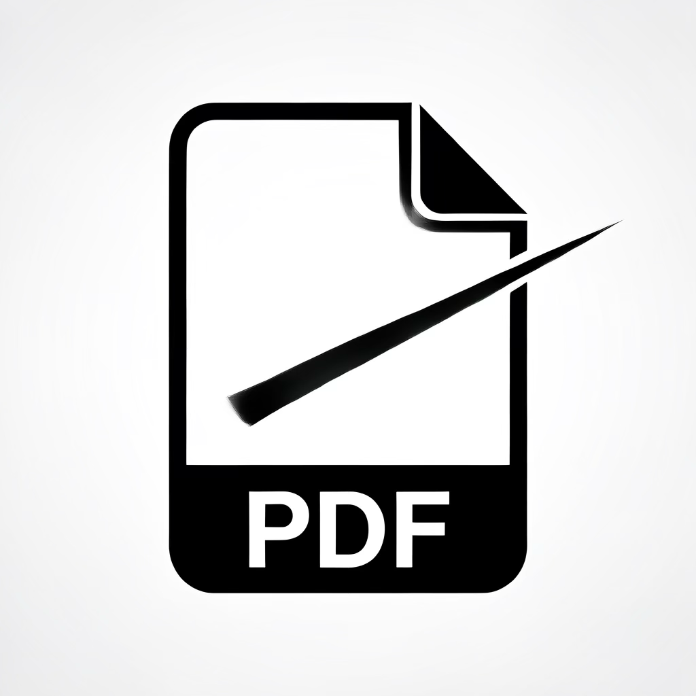

# GrayScale
## Fuctions
### overview

Make the original pdf file to **GrayScale** using pdf API.
Need to deal with the colors to ensure *clear print* without being fading off.
This app make pdf print faster without ~~color~~ with clear black and white.
Color is beatiful <u>not neccessary</u>.

- index.html
- script.js

1. Grayscaled
2. Clear looking

  

